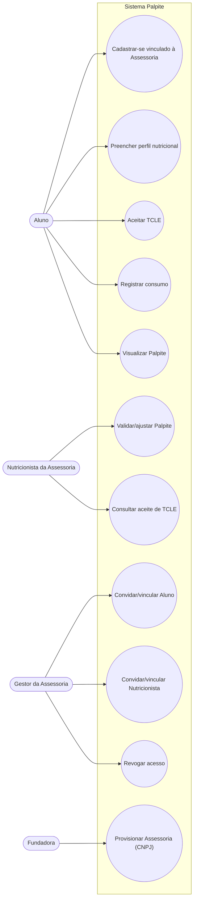
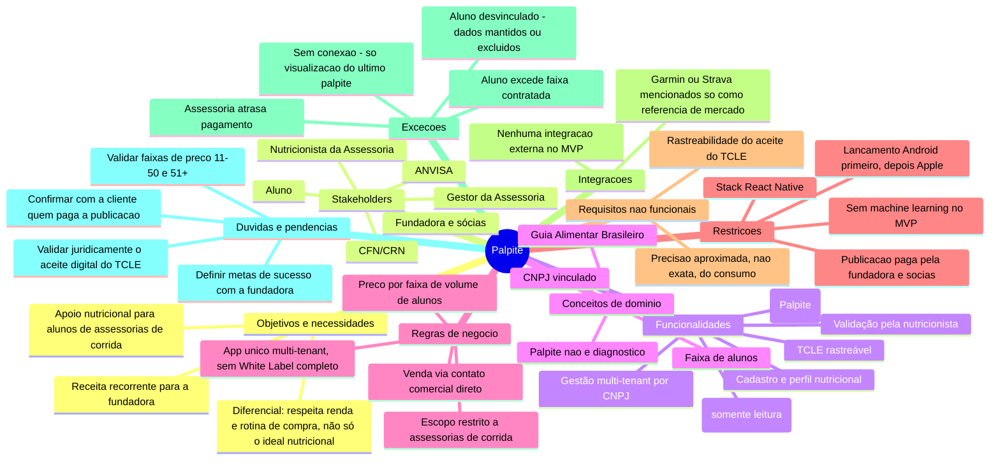

# T1 — Engenharia de Requisitos — Palpite

Documento principal do trabalho, reunindo os artefatos exigidos no item 9. Evidências completas da condução (roteiro, entrevista, Party Mode, decisões, pesquisas) estão nos anexos deste repositório: [perguntas_iniciais.md](https://github.com/LucasBerr/bmad-Palpite/blob/main/perguntas_iniciais.md), [Transcript_da_entrevista.csv](https://github.com/LucasBerr/bmad-Palpite/blob/main/Transcript_da_entrevista.csv), [composicao_participantes.md](https://github.com/LucasBerr/bmad-Palpite/blob/main/composicao_participantes.md), [sessao_party_mode.md](https://github.com/LucasBerr/bmad-Palpite/blob/main/sessao_party_mode.md) e o PRD em [_bmad-output/prd-palpite/prd-palpite.md](https://github.com/LucasBerr/bmad-Palpite/blob/main/_bmad-output/prd-palpite/prd-palpite.md) (com [addendum.md](https://github.com/LucasBerr/bmad-Palpite/blob/main/_bmad-output/prd-palpite/addendum.md)).

---

## 9.1. Roteiro de questões para a entrevista

O roteiro completo (70 questões organizadas em 11 blocos: abertura/visão do problema, público-alvo, jornada alimentar, proposta de valor, escopo/funcionalidades, nutrição/segurança, regras de negócio, plataforma/integrações, dados/privacidade, restrições/viabilidade, priorização) está em [perguntas_iniciais.md](https://github.com/LucasBerr/bmad-Palpite/blob/main/perguntas_iniciais.md), preparado antes da entrevista real com a stakeholder/fundadora do Palpite.

Durante a entrevista, o acompanhamento de respostas vagas e o aprofundamento ocorreram organicamente (perguntas de esclarecimento formuladas em tempo real, registradas no próprio transcript — ver [Transcript_da_entrevista.csv](https://github.com/LucasBerr/bmad-Palpite/blob/main/Transcript_da_entrevista.csv)), em vez de redigidas como uma lista separada. Perguntas adicionais que o grupo formulou **depois** da entrevista, durante a sessão de Party Mode, estão registradas junto de cada tópico em [sessao_party_mode.md](https://github.com/LucasBerr/bmad-Palpite/blob/main/sessao_party_mode.md) — por exemplo, as perguntas sobre prioridade de SO, uso offline, modelo de monetização e legislação brasileira.

---

## 9.2. Visão do produto

**Propósito:** ajudar assessorias de corrida a oferecer acompanhamento nutricional aos seus alunos — comparando o que o perfil de cada aluno deveria consumir (segundo o Guia Alimentar Brasileiro) com o que ele realmente consome — sem que a assessoria precise montar e gerir uma equipe de nutrição própria do zero. O objetivo principal não é substituir a nutricionista, é dar a ela e à assessoria uma ferramenta de apoio escalável.

**É:**
- Um aplicativo mobile B2B2C: vendido a assessorias de corrida (CNPJ), usado por alunos e por uma nutricionista vinculada à própria assessoria.
- Um motor de regras determinístico que gera uma sugestão ("palpite") de ajuste nutricional, sempre sujeita a validação profissional humana.
- Um produto com modelo de receita recorrente, cobrado por faixa de quantidade de alunos.

**Não é:**
- Uma ferramenta de diagnóstico clínico ou prescrição nutricional autônoma.
- Um substituto da nutricionista — toda recomendação depende da validação dela.
- Um produto de autocadastro livre para qualquer pessoa física sem vínculo com uma assessoria contratante.
- Um aplicativo de acompanhamento de treino.
- Um app White Label com marca e listagem própria por cliente — é um único app multi-tenant.

**Faz:**
- Cadastro e perfil nutricional do aluno, vinculado ao CNPJ da assessoria.
- Geração do "palpite" (recomendado vs. consumido) por motor de regras baseado no Guia Alimentar Brasileiro.
- Fluxo de TCLE (consentimento) rastreável, antes da primeira validação.
- Fila de validação/ajuste da nutricionista da assessoria.
- Gestão multi-tenant: o gestor da assessoria convida/revoga acesso de alunos e da nutricionista.
- Consulta offline (somente leitura) do último palpite validado.
- Cobrança por faixa de alunos.

**Não faz (nesta versão):**
- Reconhecimento de imagem de despensa/geladeira ou sugestão de reaproveitamento de alimentos.
- Acompanhamento de treino ou integração com apps como Garmin/Strava.
- Suporte a comorbidades (ex. diabetes).
- Machine learning / personalização aprendida — o motor é de regras determinísticas.
- Parcerias de mídia/publicidade com supermercados ou redes de varejo.
- Atendimento a escolas públicas, prefeituras/universidades ou empresas genéricas (RH) como segmento comercial.

---

## 9.3. Stakeholders

| Stakeholder | Papel | Relação com o sistema | Principais interesses/necessidades |
|---|---|---|---|
| **Fundadora** | Dona do produto e da visão de negócio | Publica e controla o app; decide o roadmap | Receita recorrente, manter controle das atualizações, validar demanda antes de escalar |
| **Sócias** (engenheira de alimentos, administradora) | Equipe de apoio da fundadora | Validação da base de nutrientes; apoio administrativo/comercial | Confiabilidade dos dados nutricionais; viabilidade comercial |
| **Gestor/Dono da Assessoria** | Comprador B2B, administra a conta da sua assessoria | Contrata o plano, convida/revoga acesso de alunos e nutricionista | Oferecer diferencial competitivo sem montar equipe de nutrição própria; previsibilidade de custo por faixa de alunos |
| **Nutricionista da Assessoria** | Responsável técnica/legal pela validação | Valida e ajusta cada palpite antes de liberá-lo ao aluno | Respaldo profissional, não ser substituída, clareza de que o app não diagnostica |
| **Aluno** | Usuário final, beneficiário | Registra consumo, recebe o palpite validado | Recomendação que respeite sua rotina e orçamento reais, não apenas o ideal nutricional |
| **Conselho Federal de Nutricionistas (CFN/CRN)** | Órgão regulador da profissão | Não usa o sistema, mas define regras que o sistema deve cumprir (Resolução nº 760/2023 — telenutrição, TCLE) | Conformidade do fluxo de validação nutricional com a regulamentação profissional |
| **ANVISA** | Órgão regulador de produtos de saúde | Não usa o sistema, mas define se ele precisa de registro como Software como Dispositivo Médico (SaMD) | O produto permanecer fora da exigência de registro, por não ser diagnóstico |

---

## 9.4. Diagrama de Casos de Uso

### Casos de uso detalhados (5 selecionados)

#### UC1 — Cadastrar-se vinculado à Assessoria
- **Objetivo:** permitir que um convidado se torne Aluno ativo, vinculado ao CNPJ correto.
- **Atores:** Aluno.
- **Pré-condições:** o CPF do convidado já deve estar associado a um CNPJ de Assessoria pelo Gestor (UC8).
- **Fluxo principal:** 1) usuário baixa o app público; 2) informa CPF; 3) sistema confirma vínculo com uma Assessoria; 4) usuário completa dados básicos de conta.
- **Fluxos alternativos/exceção:** se o CPF não estiver vinculado a nenhuma Assessoria, o cadastro é rejeitado com orientação para contatar a assessoria.
- **Pós-condições:** Aluno autenticado, vinculado à Assessoria, pronto para preencher o perfil nutricional (UC2).

#### UC3 — Aceitar TCLE
- **Objetivo:** obter e registrar o consentimento informado do Aluno antes de qualquer validação nutricional.
- **Atores:** Aluno.
- **Pré-condições:** cadastro (UC1) e perfil nutricional (UC2) completos.
- **Fluxo principal:** 1) sistema apresenta o conteúdo do TCLE; 2) Aluno aceita digitalmente; 3) sistema registra aceite com data/hora, de forma auditável.
- **Fluxos alternativos/exceção:** se o Aluno não aceitar, nenhum palpite pode ser validado para ele (bloqueia UC6 para esse Aluno).
- **Pós-condições:** aceite do TCLE registrado e consultável pela Nutricionista (UC7).

#### UC4 — Registrar consumo e visualizar Palpite
- **Objetivo:** permitir que o Aluno registre o que consumiu e, quando validado, veja a recomendação gerada.
- **Atores:** Aluno.
- **Pré-condições:** TCLE aceito (UC3).
- **Fluxo principal:** 1) Aluno registra consumo do dia; 2) motor de regras compara com o recomendado pelo perfil; 3) palpite é gerado como pendente; 4) após validação da Nutricionista (UC6), Aluno visualiza o palpite.
- **Fluxos alternativos/exceção:** sem conexão, o Aluno só consegue visualizar o último palpite já validado em cache (UC5 offline) — não pode registrar novo consumo até haver internet.
- **Pós-condições:** novo registro de consumo disponível para geração de palpite; palpite validado visível ao Aluno.

#### UC6 — Validar/ajustar Palpite
- **Objetivo:** dar respaldo profissional ao palpite antes de ele chegar ao Aluno, conforme exigido pela Resolução CFN nº 760/2023.
- **Atores:** Nutricionista da Assessoria.
- **Pré-condições:** palpite gerado pelo motor de regras para um Aluno com TCLE aceito.
- **Fluxo principal:** 1) Nutricionista abre a fila de palpites pendentes da sua Assessoria; 2) revisa o palpite de cada Aluno; 3) ajusta manualmente quando necessário; 4) aprova.
- **Fluxos alternativos/exceção:** se o Aluno ainda não aceitou o TCLE, o sistema bloqueia a validação para ele até o aceite existir.
- **Pós-condições:** palpite aprovado passa a ser visível ao Aluno (UC4/UC5); palpite não aprovado permanece oculto.

#### UC8 — Convidar/vincular Aluno
- **Objetivo:** permitir que o Gestor da Assessoria dê acesso funcional a um novo Aluno.
- **Atores:** Gestor da Assessoria.
- **Pré-condições:** Assessoria já provisionada com CNPJ (UC11).
- **Fluxo principal:** 1) Gestor informa o CPF do novo Aluno; 2) sistema vincula o CPF ao CNPJ da Assessoria; 3) Aluno convidado pode completar UC1.
- **Fluxos alternativos/exceção:** `[OPEN QUESTION]` se o número de Alunos ativos exceder a faixa contratada, o comportamento (upgrade automático, bloqueio do convite, ou cobrança proporcional) ainda não foi decidido — ver PRD, Open Question 1.
- **Pós-condições:** CPF vinculado ao CNPJ, pronto para ativação pelo próprio Aluno.

---

## 9.5. Mapa mental

---

## 9.6. Análise crítica do PRD

O PRD completo gerado com apoio do `$bmad-prd` está em [_bmad-output/prd-palpite/prd-palpite.md](https://github.com/LucasBerr/bmad-Palpite/blob/main/_bmad-output/prd-palpite/prd-palpite.md) (anexo). Abaixo, cada informação que o BMAD acrescentou e que **não veio da entrevista com a cliente real**, com a decisão do grupo.

| # | Informação/requisito acrescentado pelo BMAD | Origem real | Decisão do grupo | Justificativa |
|---|---|---|---|---|
| 1 | Perfil socioeconômico/renda como campo explícito de cadastro | Inferido do princípio geral "respeita o perfil de compra", dito pela cliente, mas sem detalhar campos | **Manter como hipótese** a validar | O princípio é da cliente; o desenho exato do campo é suposição razoável, mas não confirmada |
| 2 | Aceite digital com timestamp conta como assinatura do TCLE | Pesquisa jurídica externa (Resolução CFN 760/2023), nunca discutido com a cliente | **Manter como premissa de trabalho, com ressalva jurídica explícita** | Necessário para o produto funcionar, mas juridicamente incerto — fica marcado para revisão de advogado antes de produção real |
| 3 | Faixas de preço para 11–50 e 51+ alunos (R$4 e R$2,50/aluno) | Extrapolação de benchmarks de mercado internacional (Good Coach App, TrainHeroic, Trainerize) | **Manter como hipótese**, claramente separada do único dado real (10 alunos/R$60) | O grupo pediu à IA para propor um valor; não é uma invenção aleatória, mas também não é dado da cliente |
| 4 | Métricas de sucesso (SM-1 a SM-C1: nº de assessorias ativas, % de TCLE aceito, % de validação em 48h) | 100% proposta da IA — nunca discutido nem na entrevista nem no Party Mode | **Manter como proposta inicial a validar com a fundadora**, não descartar, pois o PRD não pode ficar sem nenhuma métrica — mas deixar evidente que são apenas ponto de partida |
| 5 | Motor de "IA" definido como regras determinísticas, não machine learning | Decisão delegada pelo grupo à IA, com justificativa técnica (time sem perfil de ML, sem orçamento discutido) | **Manter como decisão do grupo** (não é suposição não autorizada — foi explicitamente delegada) | Already uma decisão formal, não uma suposição oculta |
| 6 | Exceção "o que acontece se o Aluno exceder a faixa contratada" (UC8, Open Question 1) | Levantada pelo facilitador na verificação final do Party Mode (item 7), não pela cliente | **Descartar como requisito definido — manter como pendência genuína** | O grupo não deve inventar uma resposta; é uma pergunta real para a cliente, não uma hipótese a assumir |
| 7 | Exceção "o que acontece com os dados do Aluno ao ser desvinculado" (Open Question 3, implicação de LGPD) | Idem — levantada no encerramento do Party Mode | **Descartar como requisito definido — manter como pendência genuína**, mas sinalizada como de alta prioridade por envolver LGPD | Decisão de retenção/exclusão de dados é sensível demais para a IA decidir por conta própria |
| 8 | Quem paga a publicação nas lojas = fundadora e sócias | Decisão do grupo, mas nunca confirmada literalmente pela cliente real no transcript | **Manter como premissa de trabalho, pendente de confirmação com a cliente** | O grupo decidiu adotar como verdade para avançar os artefatos, mas isso é diferente de ela ter confirmado |

**Resumo da postura do grupo:** suposições de produto/precificação que a IA foi explicitamente autorizada a propor (itens 1, 3, 4, 5) foram mantidas como hipóteses rotuladas. Perguntas genuinamente novas, levantadas pelo próprio processo de elicitação (itens 6 e 7), foram deliberadamente **não respondidas pela IA** — ficam registradas como pendências reais para a cliente, não como requisitos. Itens de decisão de escopo que o grupo já havia fechado (item 8) permanecem como premissa de trabalho, mas com a ressalva de que não substituem a confirmação da cliente real.

---

## Anexos

- PRD completo: [_bmad-output/prd-palpite/prd-palpite.md](https://github.com/LucasBerr/bmad-Palpite/blob/main/_bmad-output/prd-palpite/prd-palpite.md)
- Addendum técnico do PRD: [_bmad-output/prd-palpite/addendum.md](https://github.com/LucasBerr/bmad-Palpite/blob/main/_bmad-output/prd-palpite/addendum.md)
- Registro completo da sessão de Party Mode: [sessao_party_mode.md](https://github.com/LucasBerr/bmad-Palpite/blob/main/sessao_party_mode.md)
- Composição de participantes (agentes e personas): [composicao_participantes.md](https://github.com/LucasBerr/bmad-Palpite/blob/main/composicao_participantes.md)
- Transcript da entrevista real: [Transcript_da_entrevista.csv](https://github.com/LucasBerr/bmad-Palpite/blob/main/Transcript_da_entrevista.csv)
- Roteiro de perguntas preparado: [perguntas_iniciais.md](https://github.com/LucasBerr/bmad-Palpite/blob/main/perguntas_iniciais.md)
