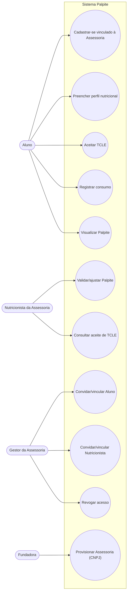
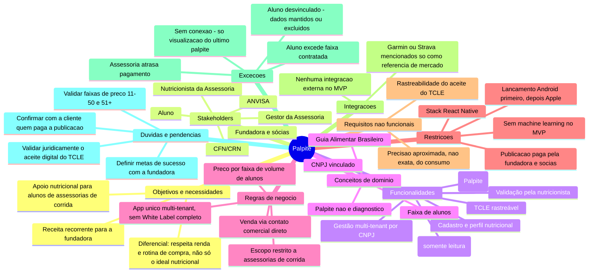

# T1 — Engenharia de Requisitos — Palpite

Documento principal do trabalho, reunindo os artefatos exigidos no item 9. Evidências completas da condução (roteiro, entrevista, Party Mode, decisões, pesquisas) estão nos anexos deste repositório: [perguntas_iniciais.md](https://github.com/LucasBerr/bmad-Palpite/blob/main/perguntas_iniciais.md), [Transcript_da_entrevista.csv](https://github.com/LucasBerr/bmad-Palpite/blob/main/Transcript_da_entrevista.csv), [composicao_participantes.md](https://github.com/LucasBerr/bmad-Palpite/blob/main/composicao_participantes.md), [sessao_party_mode.md](https://github.com/LucasBerr/bmad-Palpite/blob/main/sessao_party_mode.md) e o PRD em [_bmad-output/prd-palpite/prd-palpite.md](https://github.com/LucasBerr/bmad-Palpite/blob/main/_bmad-output/prd-palpite/prd-palpite.md) (com [addendum.md](https://github.com/LucasBerr/bmad-Palpite/blob/main/_bmad-output/prd-palpite/addendum.md)).

---

## 9.1. Roteiro de questões para a entrevista

O roteiro completo (70 questões organizadas em 11 blocos: abertura/visão do problema, público-alvo, jornada alimentar, proposta de valor, escopo/funcionalidades, nutrição/segurança, regras de negócio, plataforma/integrações, dados/privacidade, restrições/viabilidade, priorização) está em [perguntas_iniciais.md](https://github.com/LucasBerr/bmad-Palpite/blob/main/perguntas_iniciais.md), preparado antes da entrevista real com a stakeholder/fundadora do Palpite.

Durante a entrevista, o acompanhamento de respostas vagas e o aprofundamento ocorreram organicamente (perguntas de esclarecimento formuladas em tempo real, registradas no próprio transcript — ver [Transcript_da_entrevista.csv](https://github.com/LucasBerr/bmad-Palpite/blob/main/Transcript_da_entrevista.csv)), em vez de redigidas como uma lista separada. Perguntas adicionais que o grupo formulou **depois** da entrevista, durante a sessão de Party Mode, estão registradas junto de cada tópico em [sessao_party_mode.md](https://github.com/LucasBerr/bmad-Palpite/blob/main/sessao_party_mode.md) — por exemplo, as perguntas sobre prioridade de SO, uso offline, modelo de monetização e legislação brasileira.

---

## 9.2. Visão do produto

**Propósito:** ajudar assessorias de corrida a oferecer acompanhamento nutricional aos seus alunos — comparando o que o perfil de cada aluno deveria consumir (segundo o Guia Alimentar Brasileiro) com o que ele realmente consome — sem que a assessoria precise montar e gerir uma equipe de nutrição própria do zero. O objetivo principal não é substituir a nutricionista, é dar a ela e à assessoria uma ferramenta de apoio escalável.

**É:**
- Um aplicativo mobile B2B2C: vendido a assessorias de corrida (CNPJ), usado por alunos e por uma nutricionista vinculada à própria assessoria.
- Um motor de regras determinístico que gera uma sugestão ("palpite") de ajuste nutricional, sempre sujeita a validação profissional humana.
- Um produto com modelo de receita recorrente, cobrado por faixa de quantidade de alunos.

**Não é:**
- Uma ferramenta de diagnóstico clínico ou prescrição nutricional autônoma.
- Um substituto da nutricionista — toda recomendação depende da validação dela.
- Um produto de autocadastro livre para qualquer pessoa física sem vínculo com uma assessoria contratante.
- Um aplicativo de acompanhamento de treino.
- Um app White Label com marca e listagem própria por cliente — é um único app multi-tenant.

**Faz:**
- Cadastro e perfil nutricional do aluno, vinculado ao CNPJ da assessoria.
- Geração do "palpite" (recomendado vs. consumido) por motor de regras baseado no Guia Alimentar Brasileiro.
- Fluxo de TCLE (consentimento) rastreável, antes da primeira validação.
- Fila de validação/ajuste da nutricionista da assessoria.
- Gestão multi-tenant: o gestor da assessoria convida/revoga acesso de alunos e da nutricionista.
- Consulta offline (somente leitura) do último palpite validado.
- Cobrança por faixa de alunos.

**Não faz (nesta versão):**
- Reconhecimento de imagem de despensa/geladeira ou sugestão de reaproveitamento de alimentos.
- Acompanhamento de treino ou integração com apps como Garmin/Strava.
- Suporte a comorbidades (ex. diabetes).
- Machine learning / personalização aprendida — o motor é de regras determinísticas.
- Parcerias de mídia/publicidade com supermercados ou redes de varejo.
- Atendimento a escolas públicas, prefeituras/universidades ou empresas genéricas (RH) como segmento comercial.

---

## 9.3. Stakeholders

| Stakeholder | Papel | Relação com o sistema | Principais interesses/necessidades |
|---|---|---|---|
| **Fundadora** | Dona do produto e da visão de negócio | Publica e controla o app; decide o roadmap | Receita recorrente, manter controle das atualizações, validar demanda antes de escalar |
| **Sócias** (engenheira de alimentos, administradora) | Equipe de apoio da fundadora | Validação da base de nutrientes; apoio administrativo/comercial | Confiabilidade dos dados nutricionais; viabilidade comercial |
| **Gestor/Dono da Assessoria** | Comprador B2B, administra a conta da sua assessoria | Contrata o plano, convida/revoga acesso de alunos e nutricionista | Oferecer diferencial competitivo sem montar equipe de nutrição própria; previsibilidade de custo por faixa de alunos |
| **Nutricionista da Assessoria** | Responsável técnica/legal pela validação | Valida e ajusta cada palpite antes de liberá-lo ao aluno | Respaldo profissional, não ser substituída, clareza de que o app não diagnostica |
| **Aluno** | Usuário final, beneficiário | Registra consumo, recebe o palpite validado | Recomendação que respeite sua rotina e orçamento reais, não apenas o ideal nutricional |
| **Conselho Federal de Nutricionistas (CFN/CRN)** | Órgão regulador da profissão | Não usa o sistema, mas define regras que o sistema deve cumprir (Resolução nº 760/2023 — telenutrição, TCLE) | Conformidade do fluxo de validação nutricional com a regulamentação profissional |
| **ANVISA** | Órgão regulador de produtos de saúde | Não usa o sistema, mas define se ele precisa de registro como Software como Dispositivo Médico (SaMD) | O produto permanecer fora da exigência de registro, por não ser diagnóstico |

---

## 9.4. Diagrama de Casos de Uso

### Casos de uso detalhados (5 selecionados)

As especificações seguem o modelo de detalhamento de caso de uso do UP/RUP: identificação, descrição, atores, pré e pós-condições e fluxo básico ("caminho feliz"). Os passos do fluxo básico foram extraídos do PRD e do levantamento já registrado neste documento. Cada caso de uso traz ainda critérios de aceitação no formato Dado/Quando/Então — inclusive para os 6 casos de uso do diagrama que não foram detalhados (ver ao final desta seção).

#### UC1 — Cadastrar-se vinculado à Assessoria

- **Identificação:** UC1 - Cadastrar-se vinculado à Assessoria
- **Descrição:** permite que uma pessoa convidada pela Assessoria se cadastre no app público e se torne Aluno ativo, vinculado ao CNPJ correto.
- **Atores:** Aluno
- **Pré-condições:** o CPF do convidado já foi vinculado ao CNPJ de uma Assessoria pelo Gestor (UC8); o dispositivo está conectado à internet (nenhum cadastro funciona offline).
- **Pós-condições:** Aluno autenticado e vinculado à Assessoria, pronto para preencher o perfil nutricional (UC2).

**Fluxo básico:**
1. Este caso de uso começa quando o Aluno, convidado pela Assessoria, baixa o app público e inicia o cadastro
2. O Aluno informa seu CPF
3. O sistema confirma que o CPF está vinculado ao CNPJ de uma Assessoria e mostra esse vínculo ao Aluno
4. O Aluno completa os dados básicos de conta
5. O sistema cria a conta do Aluno vinculada à Assessoria e o direciona ao preenchimento do perfil nutricional (UC2)

**Critérios de aceitação:**
- **CA1.1** — Dado um CPF que não está vinculado a nenhuma Assessoria, quando o usuário tenta se cadastrar, então o cadastro é rejeitado.
- **CA1.2** — Dado um Aluno recém-cadastrado, quando ele ainda não completou o perfil mínimo (peso, altura, objetivo, atividade física), então não consegue acessar as demais funcionalidades do app.

#### UC3 — Aceitar TCLE

- **Identificação:** UC3 - Aceitar TCLE
- **Descrição:** obtém e registra o consentimento informado do Aluno sobre a telenutrição antes de qualquer validação nutricional, conforme a Resolução CFN nº 760/2023.
- **Atores:** Aluno
- **Pré-condições:** cadastro (UC1) e perfil nutricional (UC2) completos.
- **Pós-condições:** aceite do TCLE registrado de forma auditável e consultável pela Nutricionista (UC7); os Palpites do Aluno passam a poder ser validados (UC6).

**Fluxo básico:**
1. Este caso de uso começa quando o Aluno conclui o preenchimento do perfil nutricional (UC2)
2. O sistema apresenta o conteúdo do TCLE referente à telenutrição
3. O Aluno aceita o TCLE digitalmente
4. O sistema registra o aceite com identificação do Aluno, data e hora, de forma auditável

**Critérios de aceitação:**
- **CA3.1** — Dado um Aluno que ainda não aceitou o TCLE, quando existe um Palpite gerado para ele, então nenhum Palpite validado é liberado a esse Aluno.
- **CA3.2** — Dado que o Aluno aceitou o TCLE, quando o aceite é registrado, então o registro contém a identificação do Aluno, a data e a hora do aceite.

- **Observação:** `[OPEN QUESTION]` validade jurídica do aceite digital com timestamp — ver PRD, Open Question 2.

#### UC4 — Registrar consumo

- **Identificação:** UC4 - Registrar consumo
- **Descrição:** permite que o Aluno registre o que consumiu, para que o motor de regras compare com o recomendado para o seu perfil e gere um Palpite.
- **Atores:** Aluno
- **Pré-condições:** TCLE aceito (UC3); o dispositivo está conectado à internet (nenhum registro de consumo funciona offline).
- **Pós-condições:** novo registro de consumo salvo; Palpite gerado como pendente de validação, ainda não visível ao Aluno.

**Fluxo básico:**
1. Este caso de uso começa quando o Aluno registra o que consumiu no dia
2. O motor de regras compara o consumo registrado com o recomendado para o perfil do Aluno, segundo o Guia Alimentar Brasileiro
3. O sistema gera o Palpite marcado como pendente de validação da Nutricionista
4. O Palpite entra na fila de validação da Nutricionista da Assessoria (UC6)

**Critérios de aceitação:**
- **CA4.1** — Dado que o dispositivo do Aluno está sem conexão, quando ele tenta registrar um novo consumo, então o registro é bloqueado com aviso até haver conexão.
- **CA4.2** — Dado um consumo registrado, quando o Palpite é gerado, então ele fica pendente na fila de validação da Nutricionista e não é visível ao Aluno antes de ser validado.

#### UC6 — Validar/ajustar Palpite

- **Identificação:** UC6 - Validar/ajustar Palpite
- **Descrição:** dá respaldo profissional ao Palpite antes de ele chegar ao Aluno, conforme exigido pela Resolução CFN nº 760/2023.
- **Atores:** Nutricionista da Assessoria
- **Pré-condições:** Nutricionista autenticada e vinculada à Assessoria (UC9); Palpite gerado pelo motor de regras (UC4) para um Aluno com TCLE aceito (UC3).
- **Pós-condições:** o Palpite aprovado passa a ser visível ao Aluno (UC5), que é notificado; Palpite não aprovado permanece oculto.

**Fluxo básico:**
1. Este caso de uso começa quando a Nutricionista abre a fila de Palpites pendentes de validação da sua Assessoria
2. A Nutricionista revisa o Palpite gerado pelo motor de regras para cada Aluno, verificando se o TCLE dele já foi aceito
3. A Nutricionista ajusta manualmente o Palpite, quando julgar necessário
4. A Nutricionista aprova o Palpite
5. O sistema torna o Palpite visível ao Aluno e o notifica

**Critérios de aceitação:**
- **CA6.1** — Dado um Aluno que ainda não aceitou o TCLE, quando a Nutricionista tenta validar o Palpite dele, então o sistema bloqueia a validação até o aceite existir.
- **CA6.2** — Dado um Palpite que a Nutricionista não aprovou, quando o Aluno acessa o app, então esse Palpite não é visível a ele.

#### UC8 — Convidar/vincular Aluno

- **Identificação:** UC8 - Convidar/vincular Aluno
- **Descrição:** permite que o Gestor da Assessoria dê acesso funcional a um novo Aluno, vinculando o CPF dele ao CNPJ da Assessoria.
- **Atores:** Gestor da Assessoria
- **Pré-condições:** Assessoria já provisionada com CNPJ (UC11).
- **Pós-condições:** CPF vinculado ao CNPJ da Assessoria, pronto para ativação pelo próprio Aluno (UC1).

**Fluxo básico:**
1. Este caso de uso começa quando o Gestor informa o CPF do novo Aluno
2. O sistema vincula o CPF ao CNPJ da Assessoria
3. O Aluno convidado passa a poder se cadastrar no app público (UC1), aparecendo já vinculado à Assessoria

**Critérios de aceitação:**
- **CA8.1** — Dado um CPF convidado pelo Gestor, quando o vínculo ainda não foi confirmado, então esse CPF não tem acesso funcional ao app.
- **CA8.2** — Dado um CPF vinculado pelo Gestor ao CNPJ da Assessoria, quando o Aluno se autentica no app público, então ele já aparece vinculado a essa Assessoria.

- **Observação:** `[OPEN QUESTION]` comportamento quando o número de Alunos ativos excede a Faixa de alunos contratada (upgrade automático, bloqueio do convite ou cobrança proporcional) — ver PRD, Open Question 1.

#### Critérios de aceitação dos demais casos de uso

**UC2 — Preencher perfil nutricional**
- **CA2.1** — Dado um Aluno cadastrado, quando ele altera peso, altura, objetivo, atividade física/esporte praticado ou frequência de compra, então a próxima geração de Palpite usa o perfil atualizado.
- **CA2.2** — Dado que o dispositivo do Aluno está sem conexão, quando ele tenta editar o perfil, então a edição é bloqueada com aviso até haver conexão.

**UC5 — Visualizar Palpite**
- **CA5.1** — Dado um Palpite validado pela Nutricionista, quando o Aluno o visualiza, então ele é apresentado com o aviso de que não substitui orientação profissional e de que os valores são aproximados.
- **CA5.2** — Dado que o dispositivo do Aluno está sem conexão, quando ele abre o app, então consegue ver o último Palpite validado já sincronizado.

**UC7 — Consultar aceite de TCLE**
- **CA7.1** — Dado um Aluno da Assessoria, quando a Nutricionista consulta o TCLE dele, então ela vê se e quando o termo foi aceito.
- **CA7.2** — Dado que a Nutricionista está vinculada a uma Assessoria, quando ela consulta aceites de TCLE, então vê apenas os Alunos da sua própria Assessoria.

**UC9 — Convidar/vincular Nutricionista**
- **CA9.1** — Dado o CPF da Nutricionista, quando o Gestor a convida, então o CPF é vinculado ao CNPJ da Assessoria e só ganha acesso funcional após o vínculo ser confirmado.
- **CA9.2** — Dado uma Nutricionista vinculada, quando ela acessa a fila de validação, então vê apenas os Palpites pendentes dos Alunos da sua Assessoria.

**UC10 — Revogar acesso**
- **CA10.1** — Dado um Aluno ou uma Nutricionista vinculado à Assessoria, quando o Gestor revoga o acesso, então essa pessoa deixa de ter acesso funcional à conta da Assessoria.
- **CA10.2** — `[OPEN QUESTION]` o tratamento dos dados de um Aluno desvinculado (exclusão ou bloqueio) ainda não foi decidido e tem implicação de LGPD; o critério será definido após a resposta à Open Question 3 do PRD.

**UC11 — Provisionar Assessoria (CNPJ)**
- **CA11.1** — Dado um contrato comercial fechado com a Fundadora, quando a Assessoria é provisionada, então ela recebe um CNPJ provisionado e um perfil de Gestor.
- **CA11.2** — Dado que não há autosserviço, quando uma assessoria tenta se cadastrar diretamente pelo app, então não consegue criar uma conta de Assessoria sem o provisionamento feito pela Fundadora.

---

## 9.5. Mapa mental

---

## 9.6. Análise crítica do PRD

O PRD completo gerado com apoio do `$bmad-prd` está em [_bmad-output/prd-palpite/prd-palpite.md](https://github.com/LucasBerr/bmad-Palpite/blob/main/_bmad-output/prd-palpite/prd-palpite.md) (anexo). Abaixo, cada informação que o BMAD acrescentou e que **não veio da entrevista com a cliente real**, com a decisão do grupo.

| # | Informação/requisito acrescentado pelo BMAD | Origem real | Decisão do grupo | Justificativa |
|---|---|---|---|---|
| 1 | Perfil socioeconômico/renda como campo explícito de cadastro | Inferido do princípio geral "respeita o perfil de compra", dito pela cliente, mas sem detalhar campos | **Manter como hipótese** a validar | O princípio é da cliente; o desenho exato do campo é suposição razoável, mas não confirmada |
| 2 | Aceite digital com timestamp conta como assinatura do TCLE | Pesquisa jurídica externa (Resolução CFN 760/2023), nunca discutido com a cliente | **Manter como premissa de trabalho, com ressalva jurídica explícita** | Necessário para o produto funcionar, mas juridicamente incerto — fica marcado para revisão de advogado antes de produção real |
| 3 | Faixas de preço para 11–50 e 51+ alunos (R$4 e R$2,50/aluno) | Extrapolação de benchmarks de mercado internacional (Good Coach App, TrainHeroic, Trainerize) | **Manter como hipótese**, claramente separada do único dado real (10 alunos/R$60) | O grupo pediu à IA para propor um valor; não é uma invenção aleatória, mas também não é dado da cliente |
| 4 | Métricas de sucesso (SM-1 a SM-C1: nº de assessorias ativas, % de TCLE aceito, % de validação em 48h) | 100% proposta da IA — nunca discutido nem na entrevista nem no Party Mode | **Manter como proposta inicial a validar com a fundadora**, não descartar, pois o PRD não pode ficar sem nenhuma métrica — mas deixar evidente que são apenas ponto de partida |
| 5 | Motor de "IA" definido como regras determinísticas, não machine learning | Decisão delegada pelo grupo à IA, com justificativa técnica (time sem perfil de ML, sem orçamento discutido) | **Manter como decisão do grupo** (não é suposição não autorizada — foi explicitamente delegada) | Already uma decisão formal, não uma suposição oculta |
| 6 | Exceção "o que acontece se o Aluno exceder a faixa contratada" (UC8, Open Question 1) | Levantada pelo facilitador na verificação final do Party Mode (item 7), não pela cliente | **Descartar como requisito definido — manter como pendência genuína** | O grupo não deve inventar uma resposta; é uma pergunta real para a cliente, não uma hipótese a assumir |
| 7 | Exceção "o que acontece com os dados do Aluno ao ser desvinculado" (Open Question 3, implicação de LGPD) | Idem — levantada no encerramento do Party Mode | **Descartar como requisito definido — manter como pendência genuína**, mas sinalizada como de alta prioridade por envolver LGPD | Decisão de retenção/exclusão de dados é sensível demais para a IA decidir por conta própria |
| 8 | Quem paga a publicação nas lojas = fundadora e sócias | Decisão do grupo, mas nunca confirmada literalmente pela cliente real no transcript | **Manter como premissa de trabalho, pendente de confirmação com a cliente** | O grupo decidiu adotar como verdade para avançar os artefatos, mas isso é diferente de ela ter confirmado |

**Resumo da postura do grupo:** suposições de produto/precificação que a IA foi explicitamente autorizada a propor (itens 1, 3, 4, 5) foram mantidas como hipóteses rotuladas. Perguntas genuinamente novas, levantadas pelo próprio processo de elicitação (itens 6 e 7), foram deliberadamente **não respondidas pela IA** — ficam registradas como pendências reais para a cliente, não como requisitos. Itens de decisão de escopo que o grupo já havia fechado (item 8) permanecem como premissa de trabalho, mas com a ressalva de que não substituem a confirmação da cliente real.

---

## Anexos

- PRD completo: [_bmad-output/prd-palpite/prd-palpite.md](https://github.com/LucasBerr/bmad-Palpite/blob/main/_bmad-output/prd-palpite/prd-palpite.md)
- Addendum técnico do PRD: [_bmad-output/prd-palpite/addendum.md](https://github.com/LucasBerr/bmad-Palpite/blob/main/_bmad-output/prd-palpite/addendum.md)
- Registro completo da sessão de Party Mode: [sessao_party_mode.md](https://github.com/LucasBerr/bmad-Palpite/blob/main/sessao_party_mode.md)
- Composição de participantes (agentes e personas): [composicao_participantes.md](https://github.com/LucasBerr/bmad-Palpite/blob/main/composicao_participantes.md)
- Transcript da entrevista real: [Transcript_da_entrevista.csv](https://github.com/LucasBerr/bmad-Palpite/blob/main/Transcript_da_entrevista.csv)
- Roteiro de perguntas preparado: [perguntas_iniciais.md](https://github.com/LucasBerr/bmad-Palpite/blob/main/perguntas_iniciais.md)
