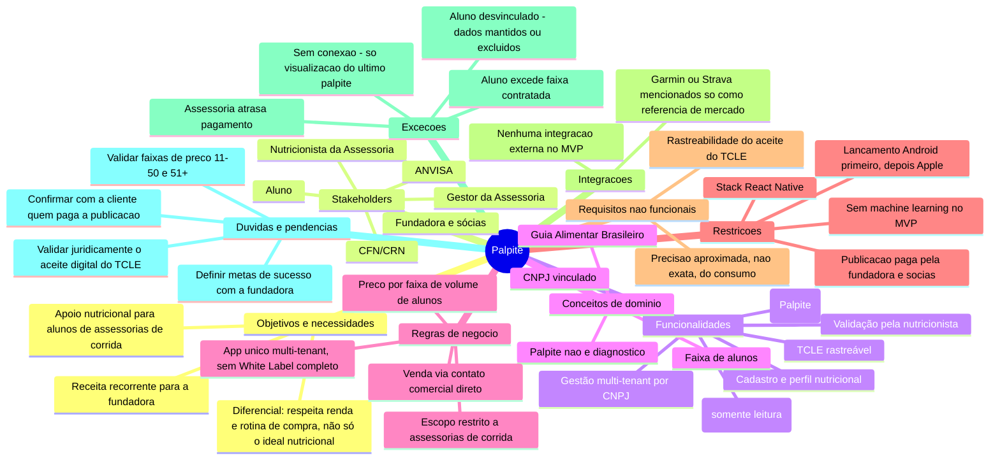

# T1 — Engenharia de Requisitos — Palpite

Documento principal do trabalho, reunindo os artefatos exigidos no item 9. Evidências completas da condução (roteiro, entrevista, Party Mode, decisões, pesquisas) estão nos anexos deste repositório: [perguntas_iniciais.md](https://github.com/LucasBerr/bmad-Palpite/blob/main/perguntas_iniciais.md), [Transcript_da_entrevista.csv](https://github.com/LucasBerr/bmad-Palpite/blob/main/Transcript_da_entrevista.csv), [composicao_participantes.md](https://github.com/LucasBerr/bmad-Palpite/blob/main/composicao_participantes.md), [sessao_party_mode.md](https://github.com/LucasBerr/bmad-Palpite/blob/main/sessao_party_mode.md) e o PRD em [_bmad-output/prd-palpite/prd-palpite.md](https://github.com/LucasBerr/bmad-Palpite/blob/main/_bmad-output/prd-palpite/prd-palpite.md) (com [addendum.md](https://github.com/LucasBerr/bmad-Palpite/blob/main/_bmad-output/prd-palpite/addendum.md)).

---

## 9.1. Roteiro de questões para a entrevista

O roteiro completo (70 questões organizadas em 11 blocos: abertura/visão do problema, público-alvo, jornada alimentar, proposta de valor, escopo/funcionalidades, nutrição/segurança, regras de negócio, plataforma/integrações, dados/privacidade, restrições/viabilidade, priorização) está em [perguntas_iniciais.md](https://github.com/LucasBerr/bmad-Palpite/blob/main/perguntas_iniciais.md), preparado antes da entrevista real com a stakeholder/fundadora do Palpite.

Durante a entrevista, o acompanhamento de respostas vagas e o aprofundamento ocorreram organicamente (perguntas de esclarecimento formuladas em tempo real, registradas no próprio transcript — ver [Transcript_da_entrevista.csv](https://github.com/LucasBerr/bmad-Palpite/blob/main/Transcript_da_entrevista.csv)), em vez de redigidas como uma lista separada. Perguntas adicionais que o grupo formulou **depois** da entrevista, durante a sessão de Party Mode, estão registradas junto de cada tópico em [sessao_party_mode.md](https://github.com/LucasBerr/bmad-Palpite/blob/main/sessao_party_mode.md) — por exemplo, as perguntas sobre prioridade de SO, uso offline, modelo de monetização e legislação brasileira.

---

## 9.2. Visão do produto

**Propósito:** ajudar assessorias de corrida a oferecer acompanhamento nutricional aos seus alunos — comparando o que o perfil de cada aluno deveria consumir (segundo o Guia Alimentar Brasileiro) com o que ele realmente consome — sem que a assessoria precise montar e gerir uma equipe de nutrição própria do zero. O objetivo principal não é substituir a nutricionista, é dar a ela e à assessoria uma ferramenta de apoio escalável.

**É:**
- Um aplicativo mobile B2B2C: vendido a assessorias de corrida (CNPJ), usado por alunos e por uma nutricionista vinculada à própria assessoria.
- Um motor de regras determinístico que gera uma sugestão ("palpite") de ajuste nutricional, sempre sujeita a validação profissional humana.
- Um produto com modelo de receita recorrente, cobrado por faixa de quantidade de alunos.

**Não é:**
- Uma ferramenta de diagnóstico clínico ou prescrição nutricional autônoma.
- Um substituto da nutricionista — toda recomendação depende da validação dela.
- Um produto de autocadastro livre para qualquer pessoa física sem vínculo com uma assessoria contratante.
- Um aplicativo de acompanhamento de treino.
- Um app White Label com marca e listagem própria por cliente — é um único app multi-tenant.

**Faz:**
- Cadastro e perfil nutricional do aluno, vinculado ao CNPJ da assessoria.
- Geração do "palpite" (recomendado vs. consumido) por motor de regras baseado no Guia Alimentar Brasileiro.
- Fluxo de TCLE (consentimento) rastreável, antes da primeira validação.
- Fila de validação/ajuste da nutricionista da assessoria.
- Gestão multi-tenant: o gestor da assessoria convida/revoga acesso de alunos e da nutricionista.
- Consulta offline (somente leitura) do último palpite validado.
- Cobrança por faixa de alunos.

**Não faz (nesta versão):**
- Reconhecimento de imagem de despensa/geladeira ou sugestão de reaproveitamento de alimentos.
- Acompanhamento de treino ou integração com apps como Garmin/Strava.
- Suporte a comorbidades (ex. diabetes).
- Machine learning / personalização aprendida — o motor é de regras determinísticas.
- Parcerias de mídia/publicidade com supermercados ou redes de varejo.
- Atendimento a escolas públicas, prefeituras/universidades ou empresas genéricas (RH) como segmento comercial.

---

## 9.3. Stakeholders

| Stakeholder | Papel | Relação com o sistema | Principais interesses/necessidades |
|---|---|---|---|
| **Fundadora** | Dona do produto e da visão de negócio | Publica e controla o app; decide o roadmap | Receita recorrente, manter controle das atualizações, validar demanda antes de escalar |
| **Sócias** (engenheira de alimentos, administradora) | Equipe de apoio da fundadora | Validação da base de nutrientes; apoio administrativo/comercial | Confiabilidade dos dados nutricionais; viabilidade comercial |
| **Gestor/Dono da Assessoria** | Comprador B2B, administra a conta da sua assessoria | Contrata o plano, convida/revoga acesso de alunos e nutricionista | Oferecer diferencial competitivo sem montar equipe de nutrição própria; previsibilidade de custo por faixa de alunos |
| **Nutricionista da Assessoria** | Responsável técnica/legal pela validação | Valida e ajusta cada palpite antes de liberá-lo ao aluno | Respaldo profissional, não ser substituída, clareza de que o app não diagnostica |
| **Aluno** | Usuário final, beneficiário | Registra consumo, recebe o palpite validado | Recomendação que respeite sua rotina e orçamento reais, não apenas o ideal nutricional |
| **Conselho Federal de Nutricionistas (CFN/CRN)** | Órgão regulador da profissão | Não usa o sistema, mas define regras que o sistema deve cumprir (Resolução nº 760/2023 — telenutrição, TCLE) | Conformidade do fluxo de validação nutricional com a regulamentação profissional |
| **ANVISA** | Órgão regulador de produtos de saúde | Não usa o sistema, mas define se ele precisa de registro como Software como Dispositivo Médico (SaMD) | O produto permanecer fora da exigência de registro, por não ser diagnóstico |

---

## 9.4. Diagrama de Casos de Uso

### Casos de uso detalhados (5 selecionados)

As especificações seguem o modelo de detalhamento de caso de uso do UP/RUP: identificação, descrição, atores, pré e pós-condições, um fluxo básico ("caminho feliz") e zero ou mais fluxos alternativos (variações e erros), numerados a partir do passo do fluxo básico em que ocorrem (ex.: **4a** desvia no passo 4). Ao final de cada caso são indicados os casos de uso e requisitos do PRD relacionados.

#### UC1 — Cadastrar-se vinculado à Assessoria

- **Identificação:** UC1 - Cadastrar-se vinculado à Assessoria
- **Descrição:** permite que uma pessoa convidada pela Assessoria crie sua conta no app público e se torne Aluno ativo, vinculado ao CNPJ correto.
- **Atores:** Aluno
- **Pré-condições:** o CPF do convidado já foi vinculado ao CNPJ de uma Assessoria pelo Gestor (UC8); o dispositivo está conectado à internet.
- **Pós-condições:** a conta do Aluno é criada, autenticada e vinculada ao CNPJ da Assessoria; o Aluno é direcionado ao preenchimento do perfil nutricional (UC2).

**Fluxo básico:**
1. Este caso de uso começa quando o Aluno abre o app pela primeira vez e escolhe a opção de cadastro
2. O sistema solicita o CPF do Aluno
3. O Aluno informa o CPF
4. O sistema verifica que o CPF está vinculado ao CNPJ de uma Assessoria e exibe o nome da Assessoria
5. O Aluno informa seus dados básicos de conta e confirma
6. O sistema cria a conta do Aluno vinculada à Assessoria e emite mensagem informando que o cadastro foi realizado

**Fluxos alternativos:**

**1a. Sem conexão com a internet:**
1. O sistema informa que o cadastro exige conexão com a internet
2. O caso de uso é encerrado

**4a. CPF não vinculado a nenhuma Assessoria:**
1. O sistema não encontra vínculo do CPF com nenhuma Assessoria
2. O sistema informa que o cadastro não é permitido e orienta o usuário a contatar sua assessoria
3. O caso de uso é encerrado

**4b. CPF já possui conta ativa:**
1. O sistema informa que já existe uma conta para esse CPF e oferece a opção de login
2. O caso de uso é encerrado

- **Casos de uso relacionados:** UC8 (vínculo prévio do CPF), UC2 (passo seguinte).
- **Requisitos relacionados:** FR-1; FR-9 (nenhum registro de dado funciona offline).

#### UC3 — Aceitar TCLE

- **Identificação:** UC3 - Aceitar TCLE
- **Descrição:** apresenta ao Aluno o Termo de Consentimento Livre e Esclarecido de telenutrição e registra seu aceite de forma auditável — condição para que qualquer Palpite dele seja validado, conforme a Resolução CFN nº 760/2023.
- **Atores:** Aluno
- **Pré-condições:** Aluno cadastrado (UC1) e com perfil nutricional preenchido (UC2); ainda não há aceite de TCLE registrado para ele.
- **Pós-condições:** aceite registrado com identificação do Aluno, data e hora, consultável pela Nutricionista (UC7); os Palpites do Aluno passam a poder ser validados (UC6).

**Fluxo básico:**
1. Este caso de uso começa quando o Aluno conclui o perfil nutricional e o sistema identifica que ainda não há TCLE aceito para ele
2. O sistema exibe o conteúdo do TCLE
3. O Aluno lê o termo e confirma o aceite
4. O sistema registra o aceite (Aluno, data e hora) de forma auditável
5. O sistema emite mensagem confirmando o aceite e libera o registro de consumo (UC4)

**Fluxos alternativos:**

**3a. Aluno não aceita o TCLE:**
1. O Aluno recusa ou fecha o termo sem aceitar
2. O sistema informa que, sem o aceite, nenhum Palpite poderá ser validado pela Nutricionista
3. O sistema não registra aceite e apresentará o termo novamente no próximo acesso
4. O caso de uso é encerrado

**4a. Falha de conexão ao registrar o aceite:**
1. O sistema não consegue registrar o aceite
2. O sistema informa a falha e solicita nova tentativa quando houver conexão
3. O caso de uso é encerrado sem aceite registrado

- **Casos de uso relacionados:** UC2 (pré-requisito), UC4, UC6 (bloqueado sem aceite), UC7 (consulta do aceite).
- **Requisitos relacionados:** RF-01 / FR-4, RNF-01 / FR-5. `[OPEN QUESTION]` validade jurídica do aceite digital com timestamp — ver PRD, Open Question 2.

#### UC4 — Registrar consumo

- **Identificação:** UC4 - Registrar consumo
- **Descrição:** permite que o Aluno registre o que consumiu, para que o motor de regras compare com o recomendado para o seu perfil (Guia Alimentar Brasileiro) e gere um Palpite pendente de validação.
- **Atores:** Aluno
- **Pré-condições:** Aluno autenticado, com perfil nutricional (UC2) e TCLE aceito (UC3); o dispositivo está conectado à internet.
- **Pós-condições:** consumo registrado; Palpite gerado com status "pendente de validação" e incluído na fila da Nutricionista (UC6); o Palpite não é visível ao Aluno até ser validado.

**Fluxo básico:**
1. Este caso de uso começa quando o Aluno escolhe a opção de registrar o consumo do dia
2. O sistema exibe o formulário de registro de consumo
3. O Aluno informa os alimentos consumidos e as quantidades aproximadas
4. O Aluno confirma o registro
5. O sistema salva o registro e o motor de regras compara o consumo com o recomendado pelo perfil do Aluno
6. O sistema gera o Palpite com status "pendente de validação" e o encaminha para a fila da Nutricionista da Assessoria
7. O sistema emite mensagem informando que o Palpite aguarda validação da Nutricionista

**Fluxos alternativos:**

**1a. Sem conexão com a internet:**
1. O sistema bloqueia o registro e avisa que é necessário estar conectado
2. O sistema oferece a consulta do último Palpite validado em cache (UC5)
3. O caso de uso é encerrado

**1b. TCLE ainda não aceito:**
1. O sistema informa que o TCLE precisa ser aceito antes de prosseguir
2. O sistema direciona o Aluno ao aceite do TCLE (UC3)

**4a. Aluno cancela o registro:**
1. O Aluno escolhe a opção Cancelar
2. O sistema descarta os dados informados
3. O caso de uso é encerrado

- **Casos de uso relacionados:** UC3 (pré-requisito), UC5 (visualização do Palpite validado / consulta offline), UC6 (validação).
- **Requisitos relacionados:** FR-3, FR-9; RNF de precisão do FR-3 (o sistema deve comunicar que os valores são aproximados).

#### UC6 — Validar/ajustar Palpite

- **Identificação:** UC6 - Validar/ajustar Palpite
- **Descrição:** permite que a Nutricionista revise, ajuste quando necessário e aprove os Palpites pendentes dos Alunos da sua Assessoria, dando o respaldo profissional exigido pela Resolução CFN nº 760/2023 antes que o Palpite chegue ao Aluno.
- **Atores:** Nutricionista da Assessoria
- **Pré-condições:** Nutricionista autenticada e vinculada à Assessoria (UC9); existe ao menos um Palpite pendente gerado pelo motor de regras (UC4).
- **Pós-condições:** o Palpite aprovado (original ou ajustado) fica visível ao Aluno (UC5), que é notificado; Palpites não aprovados permanecem ocultos ao Aluno.

**Fluxo básico:**
1. Este caso de uso começa quando a Nutricionista acessa a fila de Palpites pendentes da sua Assessoria
2. O sistema exibe a lista de Palpites pendentes, por Aluno
3. A Nutricionista seleciona o Palpite de um Aluno
4. O sistema verifica que o Aluno possui TCLE aceito e exibe o Palpite gerado, com o comparativo recomendado × consumido e o perfil do Aluno
5. A Nutricionista revisa o Palpite e o aprova
6. O sistema marca o Palpite como validado, torna-o visível ao Aluno e o notifica
7. O sistema remove o Palpite da fila de pendentes

**Fluxos alternativos:**

**2a. Não há Palpites pendentes:**
1. O sistema informa que a fila está vazia
2. O caso de uso é encerrado

**4a. Aluno sem TCLE aceito:**
1. O sistema informa que o Aluno ainda não aceitou o TCLE
2. O sistema bloqueia a aprovação desse Palpite
3. O Palpite permanece pendente e oculto ao Aluno; o fluxo retorna ao passo 2

**5a. Nutricionista ajusta o Palpite:**
1. A Nutricionista escolhe a opção Ajustar
2. A Nutricionista altera manualmente as recomendações do Palpite
3. A Nutricionista confirma o ajuste e aprova
4. O sistema salva a versão ajustada e o fluxo segue no passo 6

**5b. Nutricionista não aprova o Palpite:**
1. A Nutricionista sai do Palpite sem aprová-lo
2. O Palpite permanece pendente e oculto ao Aluno; o fluxo retorna ao passo 2

- **Casos de uso relacionados:** UC4 (origem do Palpite), UC3 e UC7 (aceite do TCLE), UC5 (visualização pelo Aluno).
- **Requisitos relacionados:** FR-6, FR-3, RF-01 / FR-4, RNF-01 / FR-5.

#### UC8 — Convidar/vincular Aluno

- **Identificação:** UC8 - Convidar/vincular Aluno
- **Descrição:** permite que o Gestor da Assessoria dê acesso a um novo Aluno, vinculando o CPF dele ao CNPJ da Assessoria.
- **Atores:** Gestor da Assessoria
- **Pré-condições:** Assessoria provisionada com CNPJ (UC11); Gestor autenticado.
- **Pós-condições:** CPF vinculado ao CNPJ da Assessoria; o convidado pode se cadastrar (UC1).

**Fluxo básico:**
1. Este caso de uso começa quando o Gestor escolhe a opção de convidar um Aluno
2. O sistema solicita o CPF do Aluno
3. O Gestor informa o CPF
4. O sistema verifica que o CPF ainda não está vinculado à Assessoria
5. O Gestor confirma o convite
6. O sistema vincula o CPF ao CNPJ da Assessoria e emite mensagem informando que o Aluno foi convidado

**Fluxos alternativos:**

**3a. CPF inválido:**
1. O sistema informa que o CPF é inválido
2. O fluxo retorna ao passo 2

**4a. CPF já vinculado à Assessoria:**
1. O sistema exibe o Aluno já vinculado e a situação do acesso (convite pendente ou acesso ativo)
2. O caso de uso é encerrado

**4b. Faixa de alunos contratada excedida** `[OPEN QUESTION]`**:**
1. O sistema identifica que o novo vínculo excederia a Faixa de alunos contratada
2. O comportamento (upgrade automático, bloqueio do convite ou cobrança proporcional) ainda não foi decidido — ver PRD, Open Question 1

- **Casos de uso relacionados:** UC11 (pré-requisito), UC1 (cadastro do convidado), UC10 (revogação do acesso).
- **Requisitos relacionados:** FR-8, FR-7.

---

## 9.5. Mapa mental

---

## 9.6. Análise crítica do PRD

O PRD completo gerado com apoio do `$bmad-prd` está em [_bmad-output/prd-palpite/prd-palpite.md](https://github.com/LucasBerr/bmad-Palpite/blob/main/_bmad-output/prd-palpite/prd-palpite.md) (anexo). Abaixo, cada informação que o BMAD acrescentou e que **não veio da entrevista com a cliente real**, com a decisão do grupo.

| # | Informação/requisito acrescentado pelo BMAD | Origem real | Decisão do grupo | Justificativa |
|---|---|---|---|---|
| 1 | Perfil socioeconômico/renda como campo explícito de cadastro | Inferido do princípio geral "respeita o perfil de compra", dito pela cliente, mas sem detalhar campos | **Manter como hipótese** a validar | O princípio é da cliente; o desenho exato do campo é suposição razoável, mas não confirmada |
| 2 | Aceite digital com timestamp conta como assinatura do TCLE | Pesquisa jurídica externa (Resolução CFN 760/2023), nunca discutido com a cliente | **Manter como premissa de trabalho, com ressalva jurídica explícita** | Necessário para o produto funcionar, mas juridicamente incerto — fica marcado para revisão de advogado antes de produção real |
| 3 | Faixas de preço para 11–50 e 51+ alunos (R$4 e R$2,50/aluno) | Extrapolação de benchmarks de mercado internacional (Good Coach App, TrainHeroic, Trainerize) | **Manter como hipótese**, claramente separada do único dado real (10 alunos/R$60) | O grupo pediu à IA para propor um valor; não é uma invenção aleatória, mas também não é dado da cliente |
| 4 | Métricas de sucesso (SM-1 a SM-C1: nº de assessorias ativas, % de TCLE aceito, % de validação em 48h) | 100% proposta da IA — nunca discutido nem na entrevista nem no Party Mode | **Manter como proposta inicial a validar com a fundadora**, não descartar, pois o PRD não pode ficar sem nenhuma métrica — mas deixar evidente que são apenas ponto de partida |
| 5 | Motor de "IA" definido como regras determinísticas, não machine learning | Decisão delegada pelo grupo à IA, com justificativa técnica (time sem perfil de ML, sem orçamento discutido) | **Manter como decisão do grupo** (não é suposição não autorizada — foi explicitamente delegada) | Already uma decisão formal, não uma suposição oculta |
| 6 | Exceção "o que acontece se o Aluno exceder a faixa contratada" (UC8, Open Question 1) | Levantada pelo facilitador na verificação final do Party Mode (item 7), não pela cliente | **Descartar como requisito definido — manter como pendência genuína** | O grupo não deve inventar uma resposta; é uma pergunta real para a cliente, não uma hipótese a assumir |
| 7 | Exceção "o que acontece com os dados do Aluno ao ser desvinculado" (Open Question 3, implicação de LGPD) | Idem — levantada no encerramento do Party Mode | **Descartar como requisito definido — manter como pendência genuína**, mas sinalizada como de alta prioridade por envolver LGPD | Decisão de retenção/exclusão de dados é sensível demais para a IA decidir por conta própria |
| 8 | Quem paga a publicação nas lojas = fundadora e sócias | Decisão do grupo, mas nunca confirmada literalmente pela cliente real no transcript | **Manter como premissa de trabalho, pendente de confirmação com a cliente** | O grupo decidiu adotar como verdade para avançar os artefatos, mas isso é diferente de ela ter confirmado |

**Resumo da postura do grupo:** suposições de produto/precificação que a IA foi explicitamente autorizada a propor (itens 1, 3, 4, 5) foram mantidas como hipóteses rotuladas. Perguntas genuinamente novas, levantadas pelo próprio processo de elicitação (itens 6 e 7), foram deliberadamente **não respondidas pela IA** — ficam registradas como pendências reais para a cliente, não como requisitos. Itens de decisão de escopo que o grupo já havia fechado (item 8) permanecem como premissa de trabalho, mas com a ressalva de que não substituem a confirmação da cliente real.

---

## Anexos

- PRD completo: [_bmad-output/prd-palpite/prd-palpite.md](https://github.com/LucasBerr/bmad-Palpite/blob/main/_bmad-output/prd-palpite/prd-palpite.md)
- Addendum técnico do PRD: [_bmad-output/prd-palpite/addendum.md](https://github.com/LucasBerr/bmad-Palpite/blob/main/_bmad-output/prd-palpite/addendum.md)
- Registro completo da sessão de Party Mode: [sessao_party_mode.md](https://github.com/LucasBerr/bmad-Palpite/blob/main/sessao_party_mode.md)
- Composição de participantes (agentes e personas): [composicao_participantes.md](https://github.com/LucasBerr/bmad-Palpite/blob/main/composicao_participantes.md)
- Transcript da entrevista real: [Transcript_da_entrevista.csv](https://github.com/LucasBerr/bmad-Palpite/blob/main/Transcript_da_entrevista.csv)
- Roteiro de perguntas preparado: [perguntas_iniciais.md](https://github.com/LucasBerr/bmad-Palpite/blob/main/perguntas_iniciais.md)
